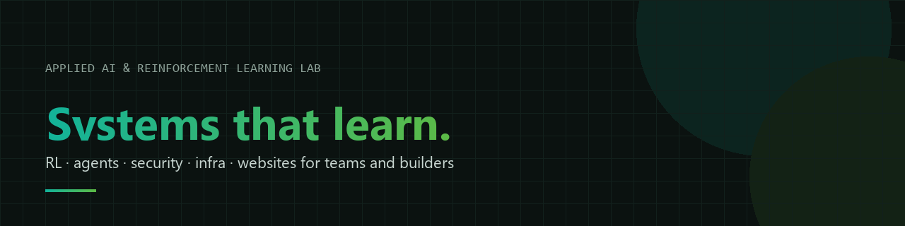

<!-- medmx: org overview shown on https://github.com/MedMxLabs -->
<p align="center">
  
</p>

<p align="center">
  <a href="https://medmx.in"></a>
  <a href="mailto:support@medmx.in"></a>
  
</p>

---

### About

**MedMx Labs** is an applied AI and reinforcement learning lab.

We build systems that improve with every episode: policies, agents, security loops, training and serving infra, and the product surfaces that sit on top. Same rigor for company teams and independent builders. You own the result.

<p align="center"><a href="https://medmx.in"><strong>medmx.in →</strong></a> · <a href="mailto:support@medmx.in?subject=%5BMedMx%20Labs%5D%20Start%20a%20project"><strong>Start a project →</strong></a></p>

---

### Focus

| Area | What that means |
| :--- | :--- |
| **Reinforcement learning systems** | Custom environments, reward design, trained policies for decisions that repeat |
| **AI automation & agents** | Agents that take real actions across your tools, with humans in the loop where it matters |
| **Cybersecurity RL** | Adversarial agents that probe networks the way attackers would, and defender policies that respond |
| **AI infrastructure & MLOps** | GPU clusters, training pipelines, serving and monitoring sized to the workload |
| **Websites & apps** | Product sites, dashboards and internal tools shipped alongside the AI work |

---

### How we work

```text
observe  →  act  →  reward  →  improve
  sₜ         aₜ        rₜ          π′
```

1. **Observe** - study the environment: data, workflows, constraints, and what "good" actually means  
2. **Act** - ship a first working baseline you can use  
3. **Reward** - agree on measurable signals and instrument them  
4. **Improve** - iterate until the numbers move, then hand over or keep tuning with you  

**Principles:** measure first · ship early, then learn · you own the result · same rigor for teams and builders

---

### Research threads

- **Reward design** - turning messy business goals into signals that don't get gamed  
- **Adversarial RL** - attackers and defenders that train each other  
- **Sample efficiency** - model-based and offline methods so systems improve without risky live trial and error  

---

### Contact

| | |
| :--- | :--- |
| Site | [medmx.in](https://medmx.in) |
| Mail | [support@medmx.in](mailto:support@medmx.in) |
| Org | [github.com/MedMxLabs](https://github.com/MedMxLabs) |
| Based in | India |

<p align="center">
  
</p>
