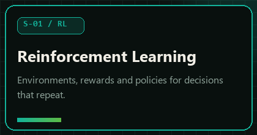
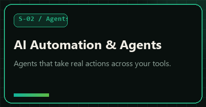
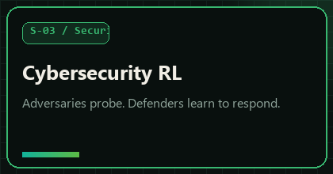
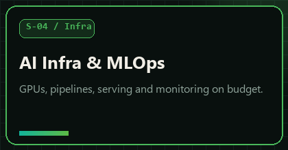
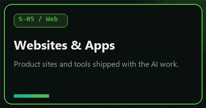
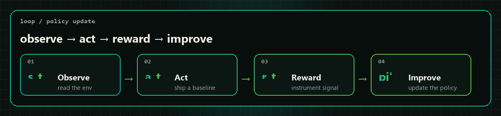
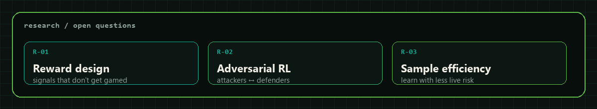
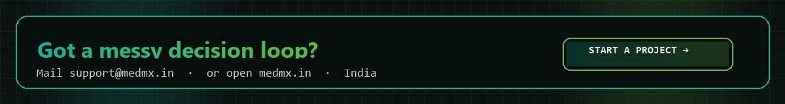

<!-- medmx labs org profile -->
<p align="center">
  
</p>

<p align="center">
  
</p>

<p align="center">
  <a href="https://medmx.in"></a>
  <a href="mailto:support@medmx.in?subject=%5BMedMx%20Labs%5D%20Start%20a%20project"></a>
  
</p>

<br/>

<p align="center">
  
</p>

<h2 align="center">Applied AI &amp; reinforcement learning lab</h2>

<p align="center">
  We build systems that get better with every episode.<br/>
  Policies. Agents. Security loops. Training and serving infra.<br/>
  Product surfaces on top. <strong>You own the result.</strong>
</p>

---

## ⌘ Focus racks

<table>
  <tr>
    <td width="50%" align="center">
      <a href="https://medmx.in/#services"></a>
    </td>
    <td width="50%" align="center">
      <a href="https://medmx.in/#services"></a>
    </td>
  </tr>
  <tr>
    <td width="50%" align="center">
      <a href="https://medmx.in/#services"></a>
    </td>
    <td width="50%" align="center">
      <a href="https://medmx.in/#services"></a>
    </td>
  </tr>
  <tr>
    <td colspan="2" align="center">
      <a href="https://medmx.in/#services"></a>
    </td>
  </tr>
</table>

---

## ⌁ The loop

<p align="center">
  
</p>

```bash
# how engagements actually run
observe  # study data, workflows, constraints, what "good" means
act      # ship a baseline you can use this week
reward   # agree on measurable signals + instrument them
improve  # iterate until the numbers move, then hand over
```

<p align="center"><code>measure first</code> · <code>ship early, then learn</code> · <code>you own the result</code> · <code>teams + builders</code></p>

---

## Ψ Research threads

<p align="center">
  
</p>

---

## ✦ Plug in

<p align="center">
  <a href="mailto:support@medmx.in?subject=%5BMedMx%20Labs%5D%20Start%20a%20project"></a>
</p>

<p align="center">
  <a href="https://medmx.in"><strong>medmx.in</strong></a>
  &nbsp;·&nbsp;
  <a href="mailto:support@medmx.in"><strong>support@medmx.in</strong></a>
  &nbsp;·&nbsp;
  <a href="https://github.com/MedMxLabs"><strong>@MedMxLabs</strong></a>
  &nbsp;·&nbsp;
  India
</p>

<p align="center">
  
</p>

<p align="center">
  <sub>backed by the loop. not the slide deck.</sub>
</p>
